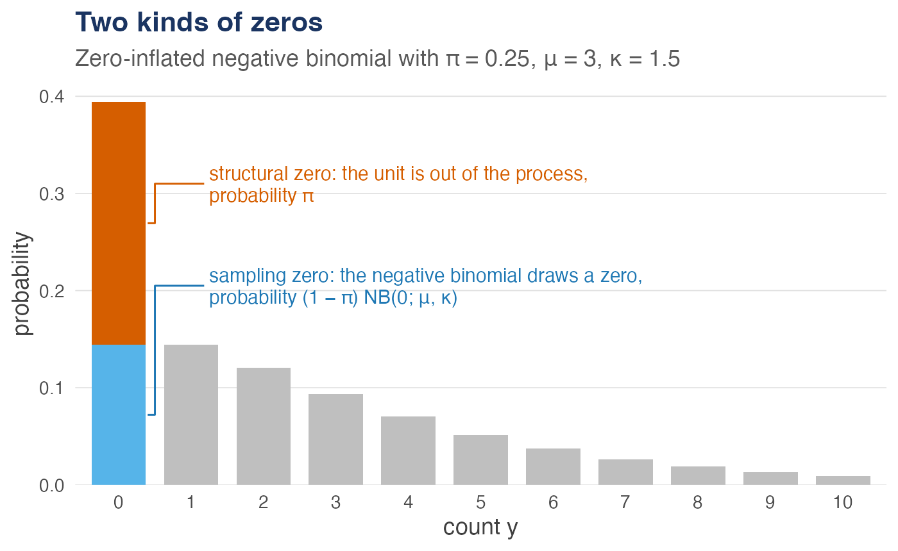
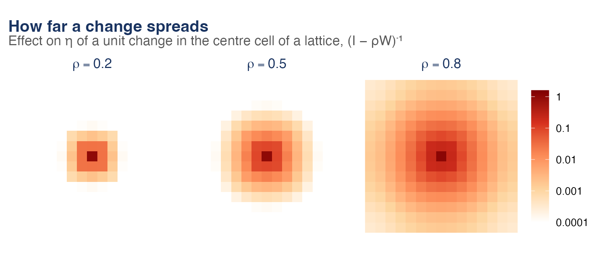

<!-- README.md is generated from README.Rmd. Please edit that file -->

```{r, include = FALSE}
knitr::opts_chunk$set(collapse = TRUE, comment = "#>")
options(digits = 4)
```

# zisar 

<!-- badges: start -->
[](https://github.com/NiccoloSalvini/zisar/actions/workflows/R-CMD-check.yaml)
[](https://doi.org/10.5281/zenodo.24118297)
<!-- badges: end -->

**zisar** fits the zero-inflated spatial autoregressive (ZISAR) model for
spatial count data with excess zeros. A simultaneous autoregressive process
on the latent log-mean of a zero-inflated negative binomial model carries
spatial spillovers, and unit-level random effects absorb residual
heterogeneity:

$$
\eta = (I - \rho W)^{-1}(X\beta + u), \qquad
y_i \sim \pi_i \, 1\{y_i = 0\} + (1 - \pi_i)\,\mathrm{NB}(e^{\eta_i}, \kappa),
\qquad \mathrm{logit}(\pi_i) = z_i'\gamma .
$$

A zero is either *structural*, from a unit out of the process, or a
*sampling* zero of the negative binomial; and a change in one unit reaches
the others through the spatial multiplier, further the larger $\rho$:

<p align="center">


</p>

With `zero_spatial = "reduced"` the zero-inflation predictor gets a
reduced-rank spatial field of its own, for structural zeros that cluster in
space.

Parameters are estimated by maximising the Laplace approximation to the
marginal likelihood with [TMB](https://cran.r-project.org/package=TMB), whose
automatic differentiation and sparse matrix algebra make tens of thousands
of spatial units feasible.

## Installation

Install the development version from GitHub:

```r
# install.packages("pak")
pak::pak("NiccoloSalvini/zisar")
```

The package compiles C++ code, so it needs a compiler: Rtools on Windows,
the Xcode command line tools on macOS.

## Example

```{r example}
library(zisar)

# 400 units on a lattice, with spatial dependence rho = 0.5
set.seed(2026)
sim <- rzisar(20, beta = c(0.5, 0.6, -0.4), rho = 0.5, gamma = c(-1, 0.9))

# Count terms before |, zero-inflation terms after it
fit <- zisar(y ~ x1 + x2 | z1, data = sim$data, W = sim$W)
summary(fit)
```

In a spatial model a coefficient is not the effect of its covariate:
`zisar_effects()` splits it into the effect on the unit itself (direct) and
the spillover on the other units (indirect).

```{r effects}
zisar_effects(fit, B = 100)
```

`vignette("zisar")` covers the model, spatial weights from real geography,
counterfactual predictions, model comparison, clustered structural zeros and
large data sets.

## Citation

```{r citation, echo = FALSE, results = "asis"}
print(citation("zisar")[1], style = "text")
```
